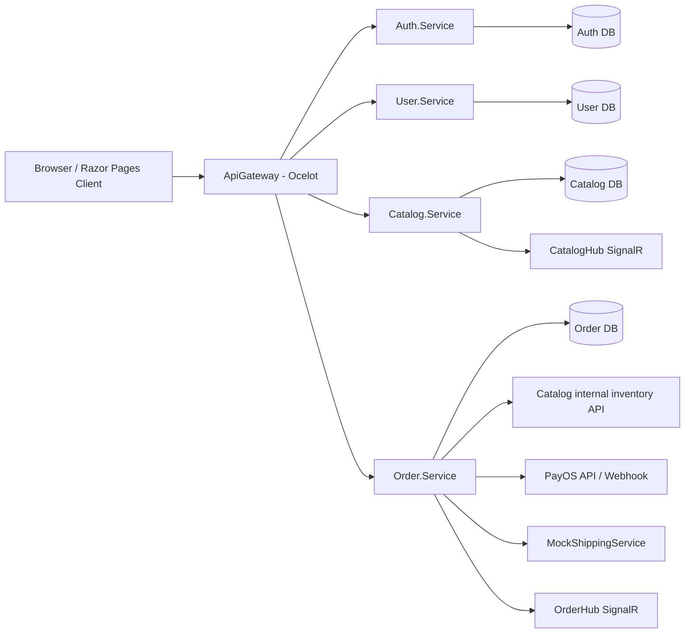
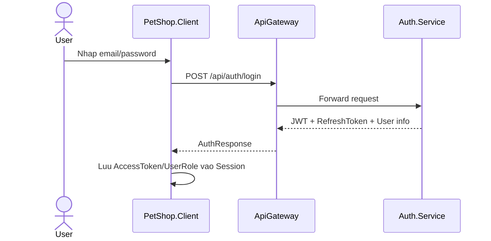
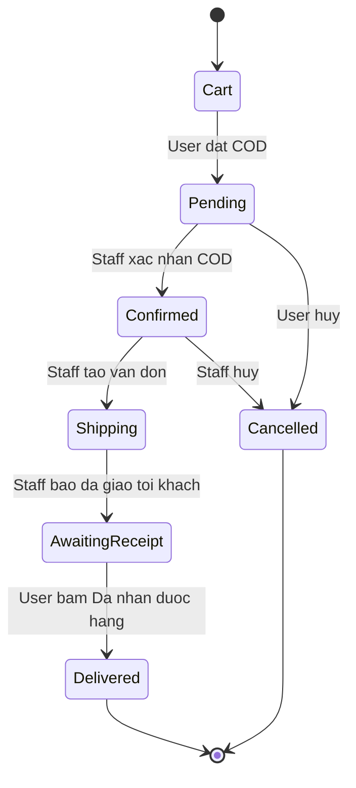
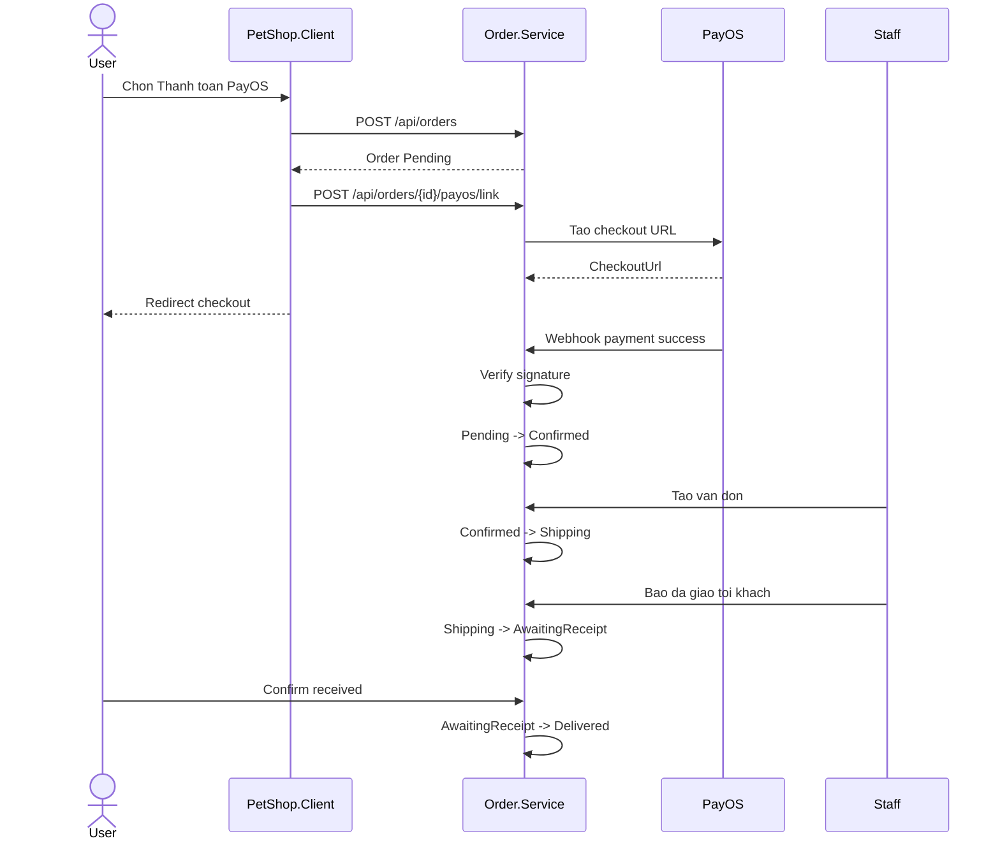
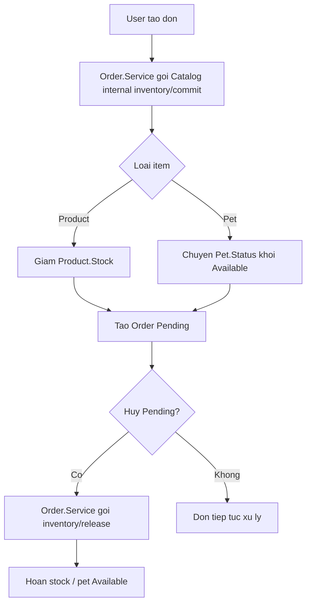
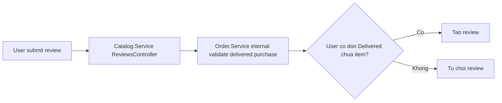

# PetShopSolution - Tai lieu tong quan, SRS va thiet ke

## 1. Thong tin chung

### 1.1 Muc dich tai lieu

Tai lieu nay mo ta tong quan project PetShopSolution, bao gom:

- Requirements Specification (SRS): yeu cau chuc nang va phi chuc nang.
- Design Document: kien truc he thong, luong nghiep vu, database schema.
- Wireframes / Mockups dang mo ta man hinh.
- API Documentation cho cac service va tich hop.
- Huong dan van hanh, test va cac rui ro con lai.

### 1.2 Tong quan san pham

PetShopSolution la he thong web ban san pham thu cung va thu cung, co phan quyen theo vai tro:

- Customer/User: xem san pham, them gio hang, dat hang COD/PayOS, theo doi don hang, xac nhan da nhan hang, danh gia san pham/pet.
- Staff: xu ly don hang, cap nhat giao hang, xem audit log.
- Admin: quan ly san pham, thu cung, danh muc, user, don hang, van don, bao cao va thong ke.

He thong duoc xay dung theo huong web client Razor Pages giao tiep voi Web API thong qua API Gateway, cac domain chinh tach thanh microservice.

### 1.3 Pham vi project

Trong pham vi hien tai, project ho tro:

- Dang ky, dang nhap, JWT, role-based authorization.
- CRUD san pham, thu cung, danh muc.
- Gio hang o client.
- Dat hang COD va PayOS that thong qua checkout URL + webhook.
- Tru/hoan ton kho san pham, chuyen trang thai pet.
- Tao van don mock voi hang ship ngoai.
- Luong giao hang co user xac nhan da nhan hang.
- Review chi khi user da co don Delivered chua item do.
- SignalR notification.
- OData demo cho quan ly product/pet.
- Export Excel va bao cao thong ke.

Ngoai pham vi hoac dang mock:

- Don vi van chuyen thuc te (GHN/GHTK/Viettel Post) chua tich hop API that, hien dang mock.
- Chua co luong khieu nai day du khi user bao chua nhan hang.
- Mot so UI van con chuoi khong dau/mojibake trong cac man hinh cu.

## 2. Kien truc tong quan

### 2.1 Thanh phan he thong



### 2.2 Cong nghe su dung

| Nhom | Cong nghe |
|---|---|
| Backend | ASP.NET Core Web API, Razor Pages |
| Gateway | Ocelot API Gateway |
| Auth | JWT Bearer, Role-based Authorization |
| ORM | Entity Framework Core |
| Database | SQL Server/local DB theo connection string tung service |
| Realtime | SignalR |
| Query nang cao | OData cho Catalog.Service |
| Payment | PayOS checkout URL + webhook signature |
| Export | ClosedXML Excel |
| UI | Razor Pages, Bootstrap |

### 2.3 Kien truc lop

Moi service chinh to chuc theo cac lop:

```text
Controller/API Layer
-> Service Layer
-> Data/Repository/DbContext Layer
-> Entity/DTO Layer
```

Client khong truy cap database truc tiep. Client goi API thong qua `IOrderClientService`, `IProductClientService`, `IAuthClientService`, ... va cac service nay dung `HttpClient` toi ApiGateway.

## 3. Requirements Specification (SRS)

### 3.1 Actor va vai tro

| Actor | Mo ta | Quyen chinh |
|---|---|---|
| Customer/User | Khach mua hang | Xem san pham, dat hang, thanh toan, theo doi don, xac nhan nhan hang, review |
| Staff | Nhan vien xu ly don | Xem don, cap nhat trang thai don, tao van don, audit log |
| Admin | Quan tri | Quan ly user, product, pet, category, xem don, bao cao, export Excel |
| PayOS | Cong thanh toan | Tra ve webhook xac nhan giao dich |
| Shipping Provider | Don vi van chuyen | Hien tai mock, sinh tracking code |

### 3.2 Yeu cau chuc nang

#### FR-01: Xac thuc va phan quyen

- User co the dang ky tai khoan Customer.
- User co the dang nhap va nhan JWT.
- He thong luu token/session tren client de goi API.
- API bao ve endpoint bang `[Authorize]` va `[Authorize(Roles = "...")]`.
- Vai tro gom `Admin`, `Staff`, `Customer`.

#### FR-02: Quan ly nguoi dung

- Admin xem danh sach user.
- Admin xem chi tiet user.
- Admin vo hieu hoa/kich hoat user.
- User xem/cap nhat thong tin co ban cua minh.

#### FR-03: Quan ly san pham

- Admin/Staff them, sua san pham.
- Staff xoa san pham (soft delete: `IsActive = false`).
- User xem danh sach, tim kiem, loc san pham.
- He thong quan ly ton kho san pham.
- OData ho tro filter, order, paging cho product trong demo.

#### FR-04: Quan ly thu cung

- Admin/Staff them, sua pet.
- Staff xoa pet (hard delete).
- User xem danh sach pet.
- Pet co trang thai `Available`, `Reserved`, `Sold`.

#### FR-05: Quan ly danh muc

- Admin/Staff them, sua danh muc.
- Admin xoa danh muc (Staff khong duoc xoa).
- Danh muc phan loai `Product` hoac `Pet`.

#### FR-06: Gio hang

- User them san pham/pet vao gio.
- San pham co the tang/giam so luong.
- Pet chi duoc mua voi so luong 1.
- Gio hang tinh tong tien va validate dia chi giao hang.

#### FR-07: Dat hang COD

- User tao don COD tu gio hang.
- Don tao voi `Status = Pending`, `PaymentStatus = CODPending`.
- He thong tru ton kho khi tao don.
- Staff xac nhan COD de chuyen `Pending -> Confirmed`.

#### FR-08: Thanh toan PayOS

- User tao don PayOS va nhan checkout URL.
- Don PayOS ban dau la `Pending / PayOSPending`.
- PayOS webhook hop le chuyen don sang `Confirmed / Paid`.
- He thong verify webhook bang checksum/signature.
- Don PayOS qua timeout se auto-cancel va hoan ton kho.

#### FR-09: Giao hang va xac nhan nhan hang

- Staff tao van don khi don `Confirmed`.
- He thong tao tracking code mock va chuyen don `Confirmed -> Shipping`.
- Staff chuyen `Shipping -> AwaitingReceipt` (bao da giao toi khach).
- User xac nhan `Da nhan duoc hang` de chuyen `AwaitingReceipt -> Delivered`.
- Staff khong duoc chot thang `Delivered`.
- `DeliveredAt` chi set khi user xac nhan da nhan hang.

#### FR-10: Huy don va ton kho

- User chi duoc huy don khi `Pending`.
- Khi huy don `Pending`, he thong hoan ton kho san pham/pet.
- Don da thanh toan/da xac nhan can xu ly ngoai luong neu hoan tien.

#### FR-11: Review/danh gia

- User chi review khi co don `Delivered` chua san pham/pet do.
- He thong chan review khi user chua mua/chua nhan hang.
- He thong chan review trung neu logic service cau hinh.

#### FR-12: Bao cao va export

- Admin xem thong ke don hang theo trang thai.
- Admin xem doanh thu.
- Admin export danh sach don hang ra Excel.

#### FR-13: Realtime notification

- Admin/Staff nhan thong bao don moi.
- User nhan thong bao khi trang thai don thay doi.
- SignalR dung `OrderHub` va group theo user/admin.

#### FR-14: OData demo

- Admin Products co the dung OData de query product.
- Ho tro `$filter`, `$orderby`, `$top`, `$skip`, `$count`.

### 3.3 Yeu cau phi chuc nang

| Ma | Yeu cau |
|---|---|
| NFR-01 | Bao mat endpoint bang JWT va role-based authorization |
| NFR-02 | Client giao tiep voi backend qua Web API, khong truy cap DB truc tiep |
| NFR-03 | Du lieu dau vao can validate o client va backend |
| NFR-04 | He thong tach domain thanh service de de bao tri |
| NFR-05 | CORS cau hinh cho client/API |
| NFR-06 | SignalR thong bao realtime voi don hang |
| NFR-07 | PayOS webhook phai verify signature truoc khi xac nhan thanh toan |
| NFR-08 | Ton kho phai nhat quan khi tao/huy don |
| NFR-09 | Build solution khong loi truoc khi demo |
| NFR-10 | Cac credential PayOS/JWT khong nen commit len source public |

## 4. Design Document

### 4.1 Cau truc solution

```text
PetShopSolution/
├── ApiGateway/                 Ocelot gateway
├── PetShop.Client/             Razor Pages web client
├── PetShop.Shared/             DTOs, enums, validators dung chung
├── Services/
│   ├── Auth.Service/           Login/register/JWT
│   ├── User.Service/           User profile/admin user management
│   ├── Catalog.Service/        Product/pet/category/review/OData/inventory
│   └── Order.Service/          Order/payment/shipping/audit/report/SignalR
├── docs/                       Tai lieu project
└── Tests/                      Test project neu co
```

### 4.2 Luong xac thuc



### 4.3 Luong mua hang COD



### 4.4 Luong mua hang PayOS



### 4.5 Luong ton kho



### 4.6 Luong review



### 4.7 Quyen theo vai tro

| Chuc nang | Customer | Staff | Admin |
|---|---:|---:|---:|
| Xem san pham/pet | Yes | Yes | Yes |
| Them vao gio/dat hang | Yes | No | No |
| Xac nhan da nhan hang | Yes | No | No |
| Tao review | Yes | No | No |
| Xem tat ca don | No | Yes | Yes |
| Xac nhan COD / cap nhat trang thai don | No | Yes | No |
| Tao van don | No | Yes | No |
| Quan ly product/pet (them/sua/xoa) | No | Yes | Yes |
| Quan ly category (them/sua) | No | Yes | Yes |
| Xoa category | No | No | Yes |
| Quan ly user (xem/VH/kich hoat) | No | No | Yes |
| Bao cao/export | No | No | Yes |
| Xem audit log | No | Yes (cua minh) | Yes (tat ca) |

## 5. Database schema

Project dung database rieng theo service. Cac quan he giua service duoc tham chieu bang id, khong dung foreign key cross-database.

### 5.1 Auth DB

#### Users

| Field | Type | Ghi chu |
|---|---|---|
| Id | int | Primary key |
| FullName | string | Ho ten |
| Email | string | Dang nhap, unique theo logic auth |
| PasswordHash | string | Mat khau hash |
| Phone | string | So dien thoai |
| Address | string? | Dia chi |
| Role | string | Admin/Staff/Customer |
| RefreshToken | string? | Refresh token |
| RefreshTokenExpiry | DateTime? | Han refresh token |
| CreatedAt | DateTime | Ngay tao |
| IsActive | bool | Trang thai tai khoan |

### 5.2 User DB

#### Users

| Field | Type | Ghi chu |
|---|---|---|
| Id | int | Primary key |
| FullName | string | Ho ten |
| Email | string | Email |
| Phone | string | So dien thoai |
| Address | string? | Dia chi |
| Role | string | Admin/Staff/Customer |
| IsActive | bool | Trang thai |
| CreatedAt | DateTime | Ngay tao |

Ghi chu: Auth.Service va User.Service dang co user schema rieng. Khi production can dong bo user giua hai DB hoac gom profile ve mot source of truth.

### 5.3 Catalog DB

#### Products

| Field | Type | Ghi chu |
|---|---|---|
| Id | int | Primary key |
| Name | string | Ten san pham |
| Description | string | Mo ta |
| Price | decimal | Gia |
| Stock | int | Ton kho |
| Category | string | Danh muc |
| ImageUrl | string? | Anh |
| CreatedAt | DateTime | Ngay tao |
| IsActive | bool | Con ban hay khong |

#### Pets

| Field | Type | Ghi chu |
|---|---|---|
| Id | int | Primary key |
| Name | string | Ten pet |
| Breed | string | Giong |
| Category | string | Dog/Cat/Bird/Fish/... |
| AgeMonths | int | Tuoi theo thang |
| Price | decimal | Gia |
| Description | string | Mo ta |
| ImageUrl | string? | Anh |
| Status | string | Available/Reserved/Sold |
| CreatedAt | DateTime | Ngay tao |

#### Reviews

| Field | Type | Ghi chu |
|---|---|---|
| Id | int | Primary key |
| UserId | int | Id user |
| UserName | string | Ten user tai thoi diem review |
| ProductId | int? | Review product |
| PetId | int? | Review pet |
| Rating | int | 1-5 |
| Comment | string | Noi dung |
| CreatedAt | DateTime | Ngay tao |

#### Categories

| Field | Type | Ghi chu |
|---|---|---|
| Id | int | Primary key |
| Name | string | Ten danh muc |
| Type | string | Product/Pet |
| Description | string? | Mo ta |
| Icon | string? | Icon/emoji |

### 5.4 Order DB

#### Orders

| Field | Type | Ghi chu |
|---|---|---|
| Id | int | Primary key |
| UserId | int | Id customer |
| UserName | string | Ten customer tai thoi diem dat |
| CustomerPhone | string | SDT giao hang |
| ShippingAddress | string | Dia chi giao |
| Note | string? | Ghi chu |
| Status | string | Pending/Confirmed/Shipping/AwaitingReceipt/Delivered/Cancelled |
| TotalAmount | decimal | Tong tien |
| IsCod | bool | COD hay PayOS |
| TrackingCode | string? | Ma van don |
| ShippingProvider | string? | Hang ship |
| TrackingUrl | string? | URL tra cuu |
| FailureReason | string? | Ly do giao that bai |
| DeliveryProofUrl | string? | Anh bang chung giao hang |
| CreatedAt | DateTime | Ngay tao |
| UpdatedAt | DateTime? | Ngay cap nhat |
| ShippedAt | DateTime? | Ngay tao van don |
| DeliveredAt | DateTime? | Ngay user xac nhan nhan hang |

#### OrderItems

| Field | Type | Ghi chu |
|---|---|---|
| Id | int | Primary key |
| OrderId | int | FK toi Orders |
| ProductId | int? | Product id |
| ProductName | string? | Snapshot ten product |
| PetId | int? | Pet id |
| PetName | string? | Snapshot ten pet |
| Quantity | int | So luong |
| UnitPrice | decimal | Don gia tai thoi diem mua |

#### StaffAuditLogs

| Field | Type | Ghi chu |
|---|---|---|
| Id | int | Primary key |
| StaffId | int | Id staff/admin thao tac |
| StaffName | string | Ten staff/admin |
| Action | string | UpdateStatus/CreateShipment/... |
| OrderId | int? | Don lien quan |
| Details | string? | Mo ta |
| CreatedAt | DateTime | Thoi gian |

## 6. Wireframes / Mockups

Day la wireframe logic de mo ta UI hien tai. UI that nam trong Razor Pages.

### 6.1 Customer home/product list

```text
+-----------------------------------------------------+
| PetShop | Trang chu | Don hang | Profile | Gio hang |
+-----------------------------------------------------+
| Search / Filter category / Sort                     |
+----------------+ +----------------+ +--------------+
| Product card   | | Pet card       | | Product card |
| image/name     | | image/name     | | image/name   |
| price/stock    | | price/status   | | price/stock  |
| Add to cart    | | Add to cart    | | Add to cart  |
+----------------+ +----------------+ +--------------+
```

### 6.2 Cart / Checkout

```text
+-------------------------+ +-------------------------+
| San pham trong gio      | | Thong tin dat hang      |
| - item, qty, subtotal   | | Dia chi giao hang       |
| - remove/clear          | | Ghi chu                 |
| Tong cong               | | Tong thanh toan         |
+-------------------------+ | [Dat hang COD]          |
                            | [Thanh toan PayOS]      |
                            +-------------------------+
```

### 6.3 User orders

```text
+-----------------------------------------------------+
| Stats: Tat ca | Dang cho | Dang giao | Cho xac nhan |
+-----------------------------------------------------+
| Filter pills: Pending Confirmed Shipping ...        |
+-----------------------------------------------------+
| Order #ID | status badge | total | expand           |
|   Dia chi, item, payment, tracking                  |
|   Actions: Huy / Tiep tuc PayOS / Da nhan hang      |
+-----------------------------------------------------+
```

### 6.4 Admin orders

```text
+-----------------------------------------------------+
| Quan ly don hang | SignalR status                   |
+-----------------------------------------------------+
| Filter status                                       |
+-----------------------------------------------------+
| # | Customer | Payment | Status | Tracking | Action |
|   |          |         |        |          | Confirm |
|   |          |         |        |          | Ship    |
|   |          |         |        |          | Detail  |
+-----------------------------------------------------+
```

### 6.5 Staff orders

```text
+-----------------------------------------------------+
| Don hang Staff                                      |
+-----------------------------------------------------+
| Filter status                                       |
+-----------------------------------------------------+
| Don | Khach | Dia chi | Tong tien | Status | Update |
| #10 | ...   | ...     | ...       | Shipping          |
|                         select -> AwaitingReceipt   |
+-----------------------------------------------------+
```

### 6.6 Admin reports

```text
+-----------------------------------------------------+
| KPI: Tong don | Doanh thu | Cho xu ly | Hoan tat    |
+-----------------------------------------------------+
| Bieu do doanh thu theo thang | Bieu do status       |
+-----------------------------------------------------+
| Bang chi tiet theo trang thai                       |
+-----------------------------------------------------+
```

## 7. API Documentation

Tat ca request client di qua ApiGateway. Duoi day la nhom endpoint chinh.

### 7.1 Auth API

| Method | Endpoint | Role | Mo ta |
|---|---|---|---|
| POST | `/api/auth/register` | Public | Dang ky customer |
| POST | `/api/auth/login` | Public | Dang nhap |
| POST | `/api/auth/refresh` | Public/token | Refresh token |
| POST | `/api/auth/change-password` | Authenticated | Doi mat khau |

### 7.2 User API

| Method | Endpoint | Role | Mo ta |
|---|---|---|---|
| GET | `/api/users` | Admin | Danh sach user |
| GET | `/api/users/{id}` | Admin/self | Chi tiet user |
| GET | `/api/users/me` | Authenticated | Thong tin user hien tai |
| PUT | `/api/users/{id}` | Admin/self | Cap nhat user |
| DELETE | `/api/users/{id}` | Admin | Vo hieu hoa user |
| PATCH | `/api/users/{id}/activate` | Admin | Kich hoat user |

### 7.3 Catalog API

| Method | Endpoint | Role | Mo ta |
|---|---|---|---|
| GET | `/api/products` | Public/Auth | Danh sach product |
| GET | `/api/products/search` | Public/Auth | Search/filter product |
| GET | `/api/products/{id}` | Public/Auth | Chi tiet product |
| POST | `/api/products` | Staff | Tao product |
| PUT | `/api/products/{id}` | Staff | Sua product |
| DELETE | `/api/products/{id}` | Staff | Xoa mem product |
| GET | `/api/pets` | Public/Auth | Danh sach pet |
| GET | `/api/pets/search` | Public/Auth | Search/filter pet |
| GET | `/api/pets/{id}` | Public/Auth | Chi tiet pet |
| POST | `/api/pets` | Staff | Tao pet |
| PUT | `/api/pets/{id}` | Staff | Sua pet |
| DELETE | `/api/pets/{id}` | Staff | Xoa pet |
| GET | `/api/categories` | Public/Auth | Danh sach category |
| GET | `/api/categories/{id}` | Public/Auth | Chi tiet category |
| POST | `/api/categories` | Admin/Staff | Tao category |
| PUT | `/api/categories/{id}` | Admin/Staff | Sua category |
| DELETE | `/api/categories/{id}` | Admin | Xoa category |

### 7.4 Review API

| Method | Endpoint | Role | Mo ta |
|---|---|---|---|
| GET | `/api/reviews/product/{productId}` | Public/Auth | Review theo product |
| GET | `/api/reviews/pet/{petId}` | Public/Auth | Review theo pet |
| POST | `/api/reviews` | Authenticated | Tao review (can co don Delivered chua item) |
| DELETE | `/api/reviews/{id}` | Authenticated | Xoa review (Admin hoac chu review) |

### 7.5 Order API

| Method | Endpoint | Role | Mo ta |
|---|---|---|---|
| GET | `/api/orders/my` | Authenticated | Don cua toi |
| POST | `/api/orders` | Authenticated | Tao don |
| POST | `/api/orders/{id}/pay` | Authenticated | Manual payment neu AllowManualConfirmation=true |
| POST | `/api/orders/{id}/payos/link` | Authenticated | Tao checkout PayOS |
| GET | `/api/orders/{id}` | Authenticated | Chi tiet don (Customer chi xem don cua minh) |
| DELETE | `/api/orders/{id}` | Authenticated | Huy don Pending (Customer chi huy don cua minh) |
| POST | `/api/orders/{id}/confirm-received` | Authenticated | Xac nhan da nhan hang (Customer) |
| GET | `/api/orders` | Admin/Staff | Tat ca don, co the filter theo status |
| PATCH | `/api/orders/{id}/status` | Staff | Cap nhat trang thai don (co validate transition) |
| POST | `/api/orders/{id}/ship` | Staff | Tao van don (goi hang ship ngoai) |
| GET | `/api/orders/audit-logs` | Admin/Staff | Lich su thao tac (Staff chi xem log cua minh) |
| GET | `/api/orders/stats` | Admin | Thong ke don hang |
| GET | `/api/orders/export` | Admin | Export Excel |
| POST | `/api/orders/payments/payos/webhook` | Public (PayOS) | Webhook thanh toan PayOS |

### 7.6 Internal API

| Method | Endpoint | Goi boi | Mo ta |
|---|---|---|---|
| POST | `/api/internal/catalog/inventory/commit` | Order.Service | Tru ton kho khi tao don |
| POST | `/api/internal/catalog/inventory/release` | Order.Service | Hoan ton kho khi huy |
| GET | `/api/orders/internal/purchases/validate` | Catalog.Service | Validate user da mua item Delivered |

### 7.7 OData endpoints

| Method | Endpoint | Mo ta |
|---|---|---|
| GET | `/odata/Products?$count=true&$filter=...&$orderby=...&$top=...&$skip=...` | Query product |
| GET | `/odata/Pets?$count=true&$filter=...&$orderby=...&$top=...&$skip=...` | Query pet |

### 7.8 SignalR hubs

| Hub | Endpoint | Mo ta |
|---|---|---|
| OrderHub | `/hubs/orders` | NewOrder, OrderStatusChanged, OrderPaid, OrderReceived, ShipmentCreated |
| CatalogHub | `/hubs/catalog` | NewProductAdded, NewPetAdded, StockUpdated, PetStatusChanged, ProductDeleted, PetDeleted |

## 8. Business rules quan trong

### 8.1 Order status

```text
Pending -> Confirmed (COD: Staff xac nhan; PayOS: webhook bao thanh toan)
Pending -> Cancelled (User hoac Staff huy)
Confirmed -> Shipping (Staff tao van don)
Confirmed -> Cancelled (Staff huy)
Shipping -> AwaitingReceipt (Staff bao da giao toi khach)
AwaitingReceipt -> Shipping (Rollback neu khach bao chua nhan)
AwaitingReceipt -> Delivered (User bam Da nhan duoc hang)
Delivered/Cancelled la trang thai ket thuc, khong chuyen tiep
```

### 8.2 Payment status

| Dieu kien | PaymentStatus |
|---|---|
| Order Cancelled | Cancelled |
| COD chua Delivered | CODPending |
| COD Delivered | CODCollected |
| PayOS Pending | PayOSPending |
| PayOS da webhook confirmed | Paid |

### 8.3 Review rule

- `ProductId` va `PetId` chi duoc chon mot trong hai.
- User phai co don `Delivered`.
- Don `Delivered` phai chua dung product/pet duoc review.

### 8.4 Inventory rule

- Product: tru stock khi tao don, hoan stock khi huy Pending.
- Pet: khi tao don khong con mua lai duoc; huy Pending thi pet quay lai trang thai co the ban.
- Khong cho dat hang neu stock khong du hoac pet khong available.

## 9. Bao mat

- JWT duoc phat hanh boi Auth.Service.
- ApiGateway va cac service validate issuer/audience/signing key.
- Role-based authorization dung `[Authorize(Roles = "...")]`.
- Client luu token trong session va gan Authorization header khi goi API.
- PayOS webhook phai verify signature truoc khi cap nhat don.
- Internal API nen dung `X-Internal-Key`; production can doi key manh va khong hardcode.

## 10. Cau hinh va van hanh

### 10.1 Cac service can chay

| Service | Vai tro |
|---|---|
| Auth.Service | Dang nhap/dang ky/JWT |
| User.Service | User profile/admin user |
| Catalog.Service | Product/pet/category/review/OData |
| Order.Service | Order/payment/shipping/report/SignalR |
| ApiGateway | Gateway cho client |
| PetShop.Client | Web UI |

### 10.2 PayOS

Can cau hinh:

- `PayOS__ClientId`
- `PayOS__ApiKey`
- `PayOS__ChecksumKey`
- Webhook public: `https://<ngrok-domain>/api/orders/payments/payos/webhook`

Khi test local, can chay ngrok tro ve ApiGateway port 5000 hoac port dang dung.

### 10.3 Build va test nhanh

```powershell
dotnet build PetShop.sln --no-restore
```

Smoke test khuyen nghi:

1. Login user.
2. Them san pham vao gio.
3. Dat COD.
4. Admin xac nhan COD.
5. Admin tao van don.
6. Staff/Admin chuyen `Shipping -> AwaitingReceipt`.
7. User bam `Da nhan duoc hang`.
8. User review san pham.
9. Tao don PayOS va thanh toan that.
10. Kiem tra webhook chuyen don sang `Confirmed/Paid`.

## 11. Testing strategy

Tai lieu testcase chi tiet nam o:

- `docs/TEST_CASES.md`
- `docs/ORDER_PAYMENT_SHIPPING_FLOW.md`
- `docs/PAYOS_REAL_PAYMENT.md`
- `docs/ODATA_DEMO.md`

Nhom test can co:

- Unit test service logic: order transition, inventory, PayOS verifier.
- Integration test API: auth, order, catalog, review.
- UI smoke test: login, cart, checkout, admin order.
- Payment test: PayOS sandbox/real checkout + webhook.
- Authorization test: staff khong duoc xoa, customer khong xem don nguoi khac.

## 12. Rui ro va de xuat nang cap

| Muc | Rui ro hien tai | De xuat |
|---|---|---|
| R1 | Shipping provider dang mock | Tich hop API GHN/GHTK/Viettel Post that |
| R2 | Chua co khieu nai khi user chua nhan hang | Them `DeliveryIssue` flow va trang admin xu ly |
| R3 | COD Pending co the giu ton kho lau | Them background cleanup cho COD pending |
| R4 | User DB va Auth DB tach user co the lech data | Dong bo user bang event hoac gom profile ve Auth/User service |
| R5 | Mot so UI con chuoi khong dau/mojibake | Chuan hoa UTF-8 va text resource |
| R6 | AutoMapper package cu co advisory trong PetShop.API cu | Update package hoac loai bo project legacy neu khong dung |
| R7 | Credential/local secrets can bao ve | Dung user-secrets/env vars, khong commit key that |

## 13. Checklist yeu cau mon hoc

| Yeu cau | Trang thai |
|---|---|
| Web App MVC/Razor Pages | Dat |
| UI phan biet Admin/User/Staff | Dat |
| Web API co phan quyen JWT/Role | Dat |
| Client goi API bang HttpClient | Dat |
| Toi thieu 3 module quan ly | Dat: users, products, pets/categories, orders |
| 3 lop + Repository/Service pattern | Dat o muc service/data/controller; repository pattern co trong project/shared legacy |
| EF Core | Dat |
| Validation dau vao | Co, can tiep tuc bo sung o mot so form |
| OData | Dat trong Catalog.Service |
| SignalR | Dat |
| CORS | Dat |
| PayOS real payment | Dat neu co credential va webhook public |

## 14. Ket luan

PetShopSolution hien la mot web app ban hang day du cac luong chinh:

- Quan ly nguoi dung va phan quyen.
- Quan ly catalog san pham/thu cung.
- Mua hang COD/PayOS.
- Quan ly don hang va giao hang co user xac nhan.
- Review sau khi mua thanh cong.
- Realtime notification, OData, bao cao va export.

Luong nghiep vu quan trong nhat da duoc chuan hoa thanh:

```text
Pending -> Confirmed -> Shipping -> AwaitingReceipt -> Delivered
```

Trang thai `Delivered` chi xuat hien khi user xac nhan da nhan hang, giup luong mua hang hop ly hon va giam rui ro staff/admin chot sai don.
