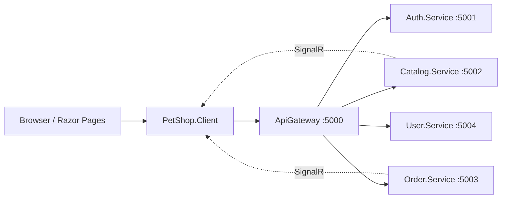
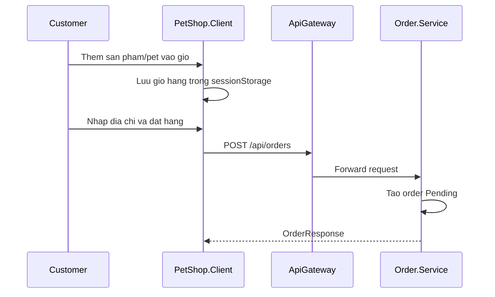
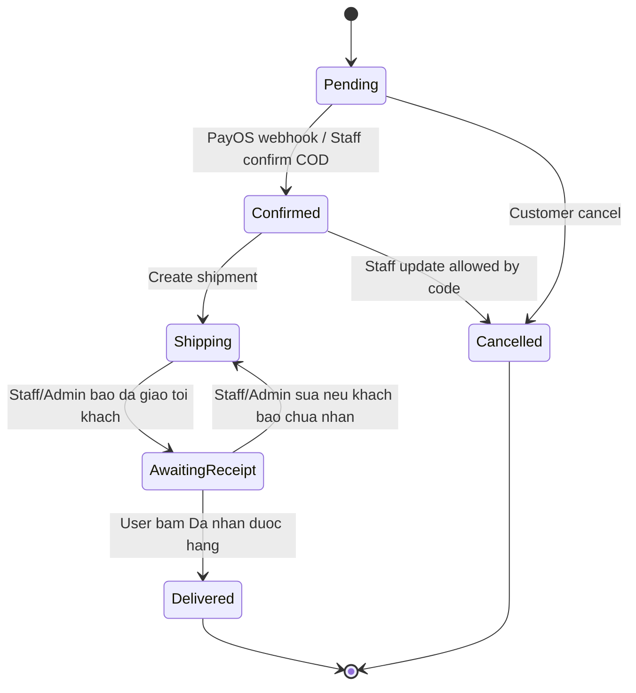

# PetShopSolution - Review luong va chuc nang

Ngay review: 2026-07-02
Ngay cap nhat: 2026-07-26

## Trang thai sau dot sua 2026-07-02

Da sua trong code:

- Order.Service khong con lay `UserId/UserName/CustomerPhone` tu request body khi tao don; controller lay tu JWT.
- JWT cua Auth.Service da them claim so dien thoai de Order.Service tao don co phone.
- Order.Service tu lookup Catalog.Service de lay ten/gia/stock/status khi tao order, khong tin `UnitPrice` tu browser.
- PayOS tao payment link that qua PayOS API va redirect user sang `checkoutUrl`; xac nhan thanh toan qua webhook.
- Da them export Excel that cho `GET /api/orders/export`.
- Da them page `/Auth/AccessDenied`.
- Da sua route cancel trong `Tests/order-service.http`.
- Da them gateway routes cho `/api/categories` va `/api/reviews`.
- Da chan nhay trang thai don hang sai vong doi.
- Staff da duoc join SignalR group van hanh de nhan thong bao don.
- Da them PayOS webhook endpoint `POST /api/orders/payments/payos/webhook` va verify signature bang `PayOS:ChecksumKey`.
- Da them internal inventory commit/release giua Order.Service va Catalog.Service.
- Da validate review dua tren don Delivered va chan review trung.
- Da go OData client/shared dead code.
- Da go package AutoMapper du trong Auth.Service de het canh bao security o service nay.

Trang thai cac muc production-ready:

- PayOS da co payment link API, webhook endpoint va verify signature bang checksum key; can cau hinh merchant credentials that.
- Da tru ton kho san pham/chuyen pet sang Sold khi tao don; khi huy don truoc giao se hoan ton kho.
- Review da validate user phai co don Delivered chua item va chan review trung.
- OData dead code trong client/shared da duoc go bo.
- Da quet UTF-8: source khong can rewrite hang loat; hien tuong mojibake chu yeu den tu console/terminal hien thi encoding.

## 1. Tong quan kien truc

PetShopSolution la mot solution ASP.NET Core/.NET 8 theo huong microservices nho, gom:

| Thanh phan | Vai tro | Port mac dinh |
| --- | --- | --- |
| PetShop.Client | Razor Pages UI cho Customer/Admin/Staff | theo launchSettings |
| ApiGateway | Ocelot gateway, route request tu client den service | 5000 |
| Auth.Service | Dang ky, dang nhap, JWT, refresh token, doi mat khau | 5001 |
| Catalog.Service | Product, Pet, Category, Review, SignalR catalog | 5002 |
| Order.Service | Order, PayOS payment, shipping mock, audit log, stats, SignalR order | 5003 |
| User.Service | Ho so user, admin quan ly user | 5004 |
| PetShop.Shared | DTO dung chung cho client | - |

Luon truy cap chinh:



## 2. Cac luong chuc nang chinh

### 2.1 Auth va phan quyen

1. User login/register o PetShop.Client.
2. Client goi `api/auth/login` hoac `api/auth/register` qua gateway.
3. Auth.Service tao JWT co claims: `NameIdentifier`, `Email`, `Name`, `Role`, `MobilePhone`.
4. Client luu `AccessToken`, `RefreshToken`, `UserRole`, `UserName`, `UserId` vao session.
5. AuthMiddleware trong client chan page theo role:
   - `/Admin` chi `Admin`.
   - `/Staff` cho `Admin` va `Staff`.
   - `/User` cho `Admin`, `Staff`, `Customer`.

Chuc nang co san:

| Chuc nang | Trang/API |
| --- | --- |
| Dang nhap | `PetShop.Client/Pages/Auth/Login` -> `POST /api/auth/login` |
| Dang ky | `PetShop.Client/Pages/Auth/Register` -> `POST /api/auth/register` |
| Doi mat khau | `POST /api/auth/change-password` |
| Refresh token | `POST /api/auth/refresh` |

### 2.2 Catalog: san pham, thu cung, danh muc, review

Customer co the xem product/pet public. Staff co the them/sua/xoa product va pet. Categories: Admin/Staff them/sua, Admin xoa.

| Nhom | API chinh | Ghi chu |
| --- | --- | --- |
| Products | `GET /api/products`, `GET /api/products/search`, `POST/PUT/DELETE /api/products` | Product delete la soft delete bang `IsActive=false` |
| Pets | `GET /api/pets`, `GET /api/pets/search`, `POST/PUT/DELETE /api/pets` | Pet delete la hard delete |
| Categories | `GET /api/categories`, `POST/PUT/DELETE /api/categories` | Write yeu cau Admin/Staff, delete Admin |
| Reviews | `GET /api/reviews/product/{id}`, `GET /api/reviews/pet/{id}`, `POST /api/reviews` | Delete cho Admin hoac chu review |

SignalR catalog co cac event: `NewProductAdded`, `StockUpdated`, `ProductDeleted`, `NewPetAdded`, `PetStatusChanged`, `PetDeleted`.

### 2.3 Gio hang va dat hang COD



Trang lien quan:

| Buoc | File |
| --- | --- |
| Hien gio hang | `PetShop.Client/Pages/Cart.cshtml` |
| Tao request dat hang | `PetShop.Client/Pages/Cart.cshtml.cs` |
| Goi API | `PetShop.Client/Services/ClientServices.cs` |
| Xu ly backend | `Services/Order.Service/Controllers/OrdersController.cs`, `Services/Order.Service/Services/OrderService.cs` |

### 2.4 Thanh toan PayOS

Hien tai PayOS da tao link thanh toan that qua API `POST /v2/payment-requests`, redirect user sang `checkoutUrl`, va verify webhook public bang `PayOS:ChecksumKey`.

Co 2 luong:

1. Tu gio hang:
   - `Cart.cshtml` submit form sang `/User/PayOS`.
   - Client tao order `Pending` voi `IsCod=false`.
   - Client goi `POST /api/orders/{id}/payos/link`.
   - Order.Service tao signature va goi PayOS API de lay `checkoutUrl`.
   - Client redirect sang PayOS checkout.

2. Tu don hang da co:
   - User vao `/User/Orders`, don `Pending` co nut `Thanh toan PayOS`.
   - Link sang `/User/PayOS?orderId={id}`.
   - Client goi `POST /api/orders/{id}/payos/link`.
   - Webhook `POST /api/orders/payments/payos/webhook` verify signature va amount roi goi `ConfirmPaidAsync`.
   - Order.Service doi order tu `Pending` sang `Confirmed`, set `IsCod=false`, them note PayOS.

### 2.5 Quan ly don hang

Trang Customer:

| Chuc nang | File/API |
| --- | --- |
| Xem don cua minh | `/User/Orders`, `GET /api/orders/my` |
| Loc status | filter local trong page model |
| Xem chi tiet expandable | `Pages/User/Orders/Index.cshtml` |
| Huy don | `DELETE /api/orders/{id}` |
| Thanh toan lai don Pending | `GET /User/PayOS?orderId=...` -> `POST /api/orders/{id}/payos/link` -> PayOS checkout -> webhook |

Trang Admin/Staff:

| Chuc nang | File/API |
| --- | --- |
| Xem tat ca don | `GET /api/orders` |
| Cap nhat status | `PATCH /api/orders/{id}/status` |
| Tao van don mock | `POST /api/orders/{id}/ship` |
| User xac nhan da nhan | `POST /api/orders/{id}/confirm-received` |
| Audit log | `GET /api/orders/audit-logs` |
| Stats | `GET /api/orders/stats` |
| Export Excel | `GET /api/orders/export` |

Vong doi status dang dung:



## 3. Nhung diem sai / rui ro can sua

### P0 - Tao don hang co kha nang sai user metadata (da xu ly)

Truoc day Order.Service co nguy co lay `UserId/UserName/CustomerPhone` tu body. Hien tai:

- Client chi gui items, dia chi, ghi chu, payment method.
- `OrdersController.Create` doc `UserId`, `UserName`, `CustomerPhone` tu JWT.
- Auth.Service da them phone claim vao token.

Luu y van hanh:

- User dang login truoc khi deploy can logout/login lai de token co phone claim moi.
- Ve dai han van can quyet dinh sync profile giua Auth.Service va User.Service.

### P0 - Gio hang tin gia tu client (da xu ly)

Truoc day `Cart.cshtml.cs` va `PayOS.cshtml.cs` lay `UnitPrice` tu JSON trong `sessionStorage`. Hien tai Order.Service da lookup Catalog.Service de lay gia/ten/stock/status tren server va commit inventory noi bo.

Huong sua:

- Order.Service chi nhan `ProductId/PetId/Quantity`.
- Order.Service goi Catalog.Service hoac dung read model de lay gia/stock/status tai server.
- Validate stock san pham va pet status `Available` truoc khi tao don.

### P1 - PayOS mock / xac thuc thanh toan (da xu ly)

Trang `PayOS` khong con QR demo va khong con nut `Toi da thanh toan`. Order.Service da:

- Tao payment link that bang PayOS API.
- Tao signature request bang checksum key.
- Redirect user sang `checkoutUrl`.
- Verify webhook signature va verify amount khop tong don truoc khi confirm.
- Tat manual confirmation bang `PayOS:AllowManualConfirmation=false`.

Can cau hinh credentials that trong env/appsettings truoc khi test giao dich that.

### P1 - Export Excel (da xu ly)

`GET /api/orders/export` da tao workbook bang ClosedXML, gom cac cot chinh: Id, Customer, Phone, Address, Status, Payment, Total, Items, TrackingCode, ShippingProvider, CreatedAt, UpdatedAt.

### P1 - Route AccessDenied thieu page

`PetShop.Client/Middleware/AuthMiddleware.cs:44` redirect `/Auth/AccessDenied`, nhung `Pages/Auth` khong co `AccessDenied.cshtml`.

Ket qua: user sai role bi redirect sang 404.

Huong sua:

- Tao `Pages/Auth/AccessDenied.cshtml` va page model neu can.
- Hoac redirect ve dashboard phu hop voi TempData message.

### P1 - Test script huy don sai route

`Services/Order.Service/Controllers/OrdersController.cs` huy don bang `DELETE /api/orders/{id}`.

Nhung `Tests/order-service.http:139` va `:145` dung `POST /api/orders/{id}/cancel`.

Huong sua:

```http
DELETE {{orderUrl}}/api/orders/2
Authorization: Bearer {{customerToken}}
```

### P1 - ApiClient nuot loi HTTP/deserialize (da xu ly mot phan)

`PetShop.Client/Services/ClientServices.cs` da doc body loi va tra `ApiResponse<T>(false, message, default)` cho cac call dang mong `ApiResponse<>`. UI se nhan duoc message ro hon thay vi chi thay null.

Con co the cai thien them bang logging status code/URL neu can audit loi production.

### P2 - OData client co method nhung khong thay route (da go bo)

`ProductClientService.GetODataAsync` va constants OData trong shared da duoc go bo; Catalog.Service cung khong con reference package OData.

Huong sua:

- Neu khong dung OData: xoa method/package de giam nhieu.
- Neu dung: cau hinh OData trong Catalog.Service va route gateway.

### P2 - Review chua validate lien ket va quyen mua hang (da xu ly)

ReviewService hien da validate:

- Chi chon dung mot Product hoac Pet.
- Product/Pet phai ton tai.
- User phai co don Delivered chua item do.
- Khong cho review trung cung item.

Huong sua:

- Validate product/pet ton tai.
- Query Order.Service de check user da mua va delivered.
- Dat unique rule theo `(UserId, ProductId/PetId)` neu can.

### P2 - Trang thai don hang cho phep nhay tu do (da xu ly)

`UpdateStatusAsync` da co transition map:

- Pending -> Confirmed/Cancelled
- Confirmed -> Cancelled
- Shipping -> AwaitingReceipt
- AwaitingReceipt -> Shipping
- Delivered/Cancelled -> terminal

Ngoai `UpdateStatusAsync`, `CreateShipmentAsync` xu ly `Confirmed -> Shipping`, va `ConfirmReceivedAsync` xu ly `AwaitingReceipt -> Delivered` khi user bam `Da nhan duoc hang`.

### P2 - User data bi tach DB giua Auth.Service va User.Service

Auth.Service va User.Service deu co bang/entity User rieng. Register tao user trong Auth DB; User.Service doc DB rieng. Neu khong co sync/seed chung, `/api/users/me` co the khong tim thay user vua dang ky.

Huong sua:

- Don gian: gom profile user vao Auth.Service trong scope project nho.
- Dung event/message sync user sang User.Service khi register/update.
- Hoac dung chung database/schema cho Auth/User neu chua can microservice phuc tap.

### P2 - SignalR group can kiem tra join group

OrderService gui event den `User_{order.UserId}` va `Admins`; CatalogService gui den `Customers`. Can dam bao Hub `OnConnectedAsync` add connection vao cac group nay theo role/userId. Neu Hub chua add group dung, realtime se khong den client.

### P3 - Ky tu tieng Viet/emoji bi mojibake o nhieu file (da quet)

PowerShell console co luc hien thi chuoi nhu `Đơn`, `Lịch sử`, `📦`. Da quet file source UTF-8 va khong thay can rewrite hang loat; hien tuong chu yeu do terminal encoding khi in ra.

Huong sua:

- Chuan hoa tat ca `.cs`, `.cshtml`, `.md` sang UTF-8.
- Cau hinh editor `.editorconfig`/VS Code `files.encoding=utf8`.
- Sau khi convert, build lai va test UI.

### P3 - Build solution bi lock do service dang chay

Lan build truoc day fail khi build full solution do cac process dang chay khoa file trong `bin`:

- `Order.Service`
- `PetShop.Client`
- `ApiGateway`
- `Auth.Service`
- `Catalog.Service`
- `User.Service`

`PetShop.API` monolith build pass nhung con warning `AutoMapper 13.0.1` co advisory high severity. Neu project nay van deploy production, can nang package AutoMapper va restore/test rieng.
- `User.Service`

Build rieng ra output tam da pass cho:

- `Order.Service`
- `PetShop.Client`
- `ApiGateway`
- `Auth.Service`
- `Catalog.Service`

Huong van hanh:

- Tat cac process dang chay truoc khi build solution.
- Hoac build ra output rieng khi chi can kiem tra compile.

## 4. Chuc nang theo role

### Customer

| Chuc nang | Trang | Tinh trang |
| --- | --- | --- |
| Xem product/pet | `/`, `/Products/Detail`, `/Pets/Detail` | Co |
| Gio hang | `/Cart` | Co, luu sessionStorage |
| Dat hang COD | `/Cart` -> `POST /api/orders` | Co, backend lay user tu JWT va lookup gia/stock tren server |
| Thanh toan PayOS | `/User/PayOS`, `POST /api/orders/{id}/payos/link`, webhook `/api/orders/payments/payos/webhook` | Checkout PayOS that + webhook verify |
| Xem lich su don | `/User/Orders` | Co |
| Huy don Pending | `/User/Orders` | Co |
| Review | UI co nut danh gia, API validate don Delivered | Co validation backend |
| Profile | `/User/Profile` | Co |

### Staff

| Chuc nang | Trang | Tinh trang |
| --- | --- | --- |
| Xem dashboard | `/Staff/Dashboard` | Co |
| Xem/cap nhat don | `/Staff/Orders` | Co |
| Tao van don | Staff page co chuc nang tao van don | Co |
| Audit log | `/Staff/AuditLog` | Co |

### Admin

| Chuc nang | Trang | Tinh trang |
| --- | --- | --- |
| Dashboard | `/Admin/Dashboard` | Co |
| Xem product/pet/category | `/Admin/Products`, `/Admin/Pets`, `/Admin/Categories` | Co (Admin chi xem, khong sua duoc) |
| Quan ly user (vo hieu/kich hoat) | `/Admin/Users` | Co |
| Xem tat ca don hang | `/Admin/Orders` | Co (Admin chi xem, Staff moi sua) |
| Bao cao stats | `/Admin/Reports` | Co |
| Export Excel | `/Admin/Reports?handler=Export` | Co |

## 5. De xuat thu tu sua

1. Da sua contract tao don: Order.Service lay user tu JWT, client khong gui user metadata.
2. Da sua tinh gia/stock/status san pham tren server va commit inventory noi bo.
3. Da them PayOS payment link API, redirect checkoutUrl va webhook verify; can dien merchant credentials that.
4. Da hoan thien export Excel.
5. Da them page `/Auth/AccessDenied`.
6. Da sua test `.http` cho route cancel.
7. Da them transition validation cho order status.
8. Da cai thien ApiClient de khong nuot message loi HTTP/deserialize.
9. Con can quyet dinh chien luoc Auth/User DB dai han: sync event hoac gom lai.
10. Da quet UTF-8; neu UI browser van loi font thi kiem tra response charset/layout.
11. Da them `.tmpbuild/` vao `.gitignore` de output build tam khong lan vao source.
12. Neu con deploy `PetShop.API` monolith, can nang `AutoMapper` de het warning bao mat NU1903.

## 6. Ghi chu ve file tam

Trong workspace hien co `.tmpbuild/`, duoc tao khi build rieng de tranh file lock trong `bin`. Thu muc nay da duoc them vao `.gitignore`.
